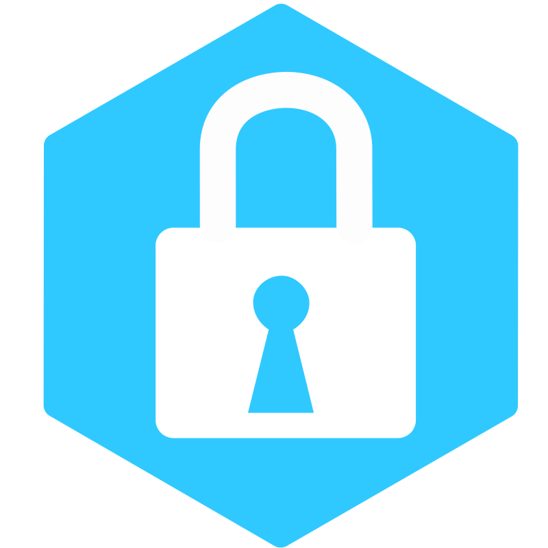

<p align="center">
  
</p>
<h1 align="center">Ease Pass (Qt 6 Edition for Linux)</h1>

A native C++ / Qt 6 (Qt Quick) rewrite of [**Ease Pass**](https://github.com/FrozenAssassine/EasePass/) for Linux (NixOS, KDE Plasma 6, GNOME, etc.), maintaining **100% byte-level file format compatibility** with the latest `.epdb` format from the original C# Windows version. The user interface follows the original app's pages: login/register, passwords, database management, settings and about.

---

## ✨ Features

- **Exact File Format Compatibility**:
  - Full support for the latest `.epdb` file format (EpdbV2DbVersion / Version 1.4).
  - Uses **Argon2id** key derivation (250 MB memory, 10 iterations, 10 lanes) and **AES-256-CBC** with PKCS7 padding.
  - Seamlessly opens database files created with the original Windows Ease Pass and saves databases readable by both versions.
- **Password Management**:
  - List entries with website favicons or auto-generated high-contrast circular letter avatars.
  - View, Add, Edit, and Delete password entries.
  - Real-time search across Name, Username, Email, Website, Notes, and Tags.
  - Sorting by Name (A-Z, Z-A), Username, Website, and Usage frequency.
- **Two-Factor Authentication (2FA / TOTP)**:
  - Supports RFC 6238 TOTP tokens (SHA1, SHA256, SHA512, custom digits and intervals).
  - **Countdown Validity Progress Bar**: Live visual bar and second countdown showing how long the current code remains valid (a requested feature missing in the original app).
  - **QR Code Scanning**:
    - Scan QR code from an image file.
    - Scan QR code from system clipboard (image or `otpauth://` URI).
    - Screen capture to scan QR codes directly from the screen (xdg-desktop-portal on Wayland).
    - Webcam scanning (with Qt Multimedia).
- **Password Generator**:
  - Cryptographically secure generator with configurable length (4 to 64 chars).
  - Custom rules for uppercase, lowercase, numbers, and special symbols.
- **Website Icons** (opt-in, off by default):
  - Fetches domain favicons asynchronously with local caching in `~/.cache/EasePass/icons`.
  - Fallback to Google Favicon service and color-hashed initials avatars.
- **Security**: clipboard cleared automatically and on lock, auto-logout after inactivity, owner-only files, no secrets in logs. See [docs/SECURITY.md](docs/SECURITY.md).
- **Desktop Integration**:
  - Qt Quick application following the system light/dark scheme, with keyboard shortcuts (Ctrl+F search, Ctrl+N new entry, Ctrl+E/F2 edit).
  - English, German and Portuguese (Brazil), switchable at runtime.
  - Includes `.desktop` entry, AppStream metadata, `.epdb` MIME type and scalable icons; a single instance receives files opened from the file manager.

---

## ❄️ NixOS & Flakes Installation

Ease Pass provides first-class support for Nix Flakes and NixOS.

### Quick Run (No Installation Required)

You can run Ease Pass directly using `nix run`:

```bash
nix run github:finn-freitag/EasePassQt
```

### Install via NixOS Configuration (`flake.nix`)

1. Add EasePassQt to your flake `inputs`:

```nix
{
  inputs = {
    nixpkgs.url = "github:NixOS/nixpkgs/nixos-unstable";
    easepass.url = "github:finn-freitag/EasePassQt";
  };

  outputs = { self, nixpkgs, easepass, ... }: {
    nixosConfigurations.yourhostname = nixpkgs.lib.nixosSystem {
      system = "x86_64-linux";
      modules = [
        # Option A: Install via environment.systemPackages
        {
          environment.systemPackages = [
            easepass.packages.x86_64-linux.default
          ];
        }

        # Option B: Use the included NixOS module
        easepass.nixosModules.default
        {
          programs.easepass.enable = true;
        }
      ];
    };
  };
}
```

### Home Manager

Add it to your `home.packages`:

```nix
{
  home.packages = [
    inputs.easepass.packages.${pkgs.system}.default
  ];
}
```

### Temporary Profile Install

```bash
nix profile install github:finn-freitag/EasePassQt
```

---

## 🛠️ Building from Source

### Using `nix-shell` (Recommended for Local Development)

A `shell.nix` (and the flake's dev shell, `nix develop`) is included with all required dependencies (`qt6`, `openssl`, `libargon2`, `zxing-cpp`, `cmake`, `gcc`, `pkg-config`).

1. Enter the nix shell and build:
   ```bash
   nix-shell --run "mkdir -p build && cd build && cmake .. && make -j\$(nproc)"
   ```

2. Run Ease Pass:
   ```bash
   nix-shell --run "./build/easepass"
   ```

3. Run the automated test suite:
   ```bash
   nix-shell --run "ctest --test-dir build --output-on-failure"
   ```

### Building on Other Linux Distributions

Ensure you have the following installed:
- Qt >= 6.11 (Core, Gui, Widgets, Network, Svg, PrintSupport, Qml, Quick, QuickControls2, DBus on Linux, LinguistTools, Test; Multimedia optional for webcam scanning)
- OpenSSL (libcrypto)
- `libargon2`
- `zxing-cpp` (>= 2.0)
- CMake (>= 3.21) and a C++20 compiler

Then build and install:
```bash
mkdir -p build && cd build
cmake ..
make -j$(nproc)
sudo make install
```

More details (targets, tests, translations, platform notes): [docs/BUILD.md](docs/BUILD.md).
